# Demos

Every demo on this page drove a real SolidWorks 2026 session through the same
MCP tools an MCP client calls, and checked what SolidWorks reported back.
Each GIF was captured from that run, with the tool call and its result
captioned beneath the SolidWorks window.

Each entry has:

- **what it shows**, and what the run checked;
- **the prompt**: the real one for the prompt-to-drawing demo. The other demos
  are live tests that call the tools directly, so their prompt is an example
  of what you would type to get the same calls;
- **the tool calls**, in order;
- **the source**: the test that made the GIF. Run any of them yourself (see
  [Run a demo yourself](#run-a-demo-yourself)).

## From a prompt to an assembly drawing {#prompt-to-drawing}

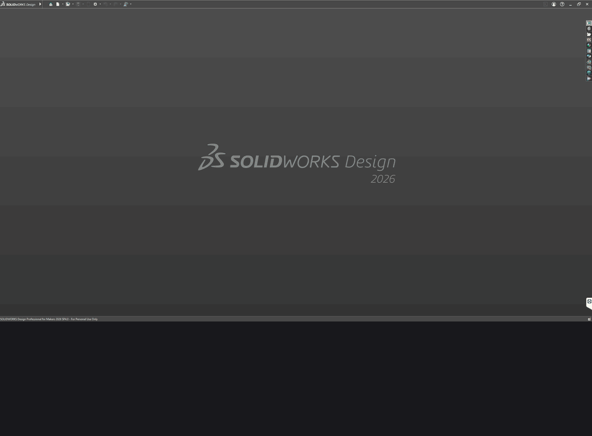

**Prompt**

> Make a 100 x 50 x 10 mm AISI 1020 mounting plate with four M5 clearance
> holes, 10 mm in from each edge, and draw it fully dimensioned. Stack two of
> them 10 mm apart, check the result, and draw the assembly with a BOM.

**What it shows.** The 58 tool calls an agent made from that prompt, replayed
against SolidWorks 2026 and recorded (sped up five times). It builds a fully
defined plate sketch, extrudes it, applies the material and checks the part
with `verify_model`. It then makes an A3 drawing with every model dimension
laid out clear of the others, and adds datums A, B and C and a position
tolerance on the holes. Two plates are mated 10 mm apart and checked, and the
assembly gets its own drawing with a BOM and the same GD&T.

Each result is checked against a hand calculation:

- the plate's volume, 49 049.7 mm³ (the block less four Ø5.5 holes);
- its mass, 0.3875 kg of AISI 1020;
- the 10 mm gap, read from the 30 mm height of the stack;
- the BOM quantity, two plates.

!!! note "Not the shortest route"
    The demo is paced for reading, and its calls are chosen to show what the
    tools can do, not to be the fewest calls. Every sketch dimension is added
    one at a time, and the mate distance is stepped down from 60 to 20 mm only
    so the plates are seen coming together.

**The plan the agent made**

1. Sketch on Top: a 100 x 50 outline from the origin and four Ø5.5 circles
   (one Ø, the rest equal), each located from two edges; extrude 10 mm.
2. AISI 1020, then `verify_model`: 49 049.7 mm³, 0.3875 kg, 1 feature.
3. Plate drawing: A3, model dimensions, centre marks, notes, title block.
   GD&T: datums A, B, C and position Ø0.2 Ⓜ on the holes.
4. Assembly: the plate twice; Front and Right planes coincident, Top planes
   60 mm apart, brought down to 20 (a 10 mm gap). `verify_model`: 2 parts,
   3 mates, no interference.
5. Assembly drawing with a BOM (the plate, QTY 2) and the same GD&T.

**The tool calls, in stages**

1. **Sketch** (24 calls): `create_sketch` on Top; four `add_line` for the
   outline; `add_circle` for each hole; `add_sketch_dimension` for the 100,
   the 50, one Ø5.5 and each hole 10 mm from two edges;
   `add_sketch_constraint` making the other three holes equal; `exit_sketch`.
2. **Check and extrude**: `check_sketch_fully_defined`, then
   `create_extrusion` 10 mm, which reads back +49 049.7 mm³.
3. **Material and check**: `list_model_dimensions` (finds the Ø5.5 by
   value), `set_material` AISI 1020, `verify_model`.
4. **Plate drawing**: `generate_drawing_package` PS-01 (A3, four views,
   dimensions, notes, title block, PDF), `auto_center_marks`.
5. **GD&T**: `add_datum_tag` A, B and C, then `add_gtol` ⊕ Ø0.2 Ⓜ A|B|C on
   the Ø5.5.
6. **Assembly**: `insert_component` twice, `list_components`, three
   `add_mate`, ten `set_dimension` stepping the gap down, `verify_model`.
7. **Assembly drawing**: `set_custom_property` Material,
   `generate_drawing_package` PS-02 with `include_bom`, then the same datums
   and position frame.

??? info "All 58 calls with their arguments"

    | # | Tool | Arguments |
    | --- | --- | --- |
    | 1 | `create_sketch` | `{"plane": "Top"}` |
    | 2 | `add_line` | `{"x1": 0.0, "y1": 0.0, "x2": 100.0, "y2": 0.0}` |
    | 3 | `add_line` | `{"x1": 100.0, "y1": 0.0, "x2": 100.0, "y2": 50.0}` |
    | 4 | `add_line` | `{"x1": 100.0, "y1": 50.0, "x2": 0.0, "y2": 50.0}` |
    | 5 | `add_line` | `{"x1": 0.0, "y1": 50.0, "x2": 0.0, "y2": 0.0}` |
    | 6 | `add_sketch_dimension` | `{"entity1": "Line_1", "entity2": null, "dimension_type": "linear", "value": 100.0}` |
    | 7 | `add_sketch_dimension` | `{"entity1": "Line_4", "entity2": null, "dimension_type": "linear", "value": 50.0}` |
    | 8 | `add_circle` | `{"center_x": 10.0, "center_y": 10.0, "radius": 2.75}` |
    | 9 | `add_sketch_dimension` | `{"entity1": "Circle_7", "entity2": null, "dimension_type": "diameter", "value": 5.5}` |
    | 10 | `add_sketch_dimension` | `{"entity1": "Line_4", "entity2": "Circle_7", "dimension_type": "linear", "value": 10.0}` |
    | 11 | `add_sketch_dimension` | `{"entity1": "Line_1", "entity2": "Circle_7", "dimension_type": "linear", "value": 10.0}` |
    | 12 | `add_circle` | `{"center_x": 90.0, "center_y": 10.0, "radius": 2.75}` |
    | 13 | `add_sketch_constraint` | `{"entity1": "Circle_7", "entity2": "Circle_11", "relation_type": "equal"}` |
    | 14 | `add_sketch_dimension` | `{"entity1": "Line_2", "entity2": "Circle_11", "dimension_type": "linear", "value": 10.0}` |
    | 15 | `add_sketch_dimension` | `{"entity1": "Line_1", "entity2": "Circle_11", "dimension_type": "linear", "value": 10.0}` |
    | 16 | `add_circle` | `{"center_x": 90.0, "center_y": 40.0, "radius": 2.75}` |
    | 17 | `add_sketch_constraint` | `{"entity1": "Circle_7", "entity2": "Circle_15", "relation_type": "equal"}` |
    | 18 | `add_sketch_dimension` | `{"entity1": "Line_2", "entity2": "Circle_15", "dimension_type": "linear", "value": 10.0}` |
    | 19 | `add_sketch_dimension` | `{"entity1": "Line_3", "entity2": "Circle_15", "dimension_type": "linear", "value": 10.0}` |
    | 20 | `add_circle` | `{"center_x": 10.0, "center_y": 40.0, "radius": 2.75}` |
    | 21 | `add_sketch_constraint` | `{"entity1": "Circle_7", "entity2": "Circle_19", "relation_type": "equal"}` |
    | 22 | `add_sketch_dimension` | `{"entity1": "Line_4", "entity2": "Circle_19", "dimension_type": "linear", "value": 10.0}` |
    | 23 | `add_sketch_dimension` | `{"entity1": "Line_3", "entity2": "Circle_19", "dimension_type": "linear", "value": 10.0}` |
    | 24 | `exit_sketch` | `{}` |
    | 25 | `check_sketch_fully_defined` | `{"sketch_name": "Sketch1"}` |
    | 26 | `create_extrusion` | `{"sketch_name": "Sketch1", "depth": 10.0}` |
    | 27 | `list_model_dimensions` | `{"feature_name": "Sketch1"}` |
    | 28 | `set_material` | `{"material_name": "AISI 1020"}` |
    | 29 | `verify_model` | `{"volume_mm3": 49049.7, "mass_kg": 0.3875, "bounding_box_mm": [100.0, 10.0, 50.0], "feature_count": 1, "solid_body_count": 1}` |
    | 30 | `generate_drawing_package` | `{"model_path": "Demo Plate.SLDPRT", "output_dir": "drawings", "title": "Demo Plate", "drawing_number": "PS-01", "author": "solidworks-mcp", "notes": ["4 X Ø5.5 THRU, M5 CLEARANCE", "GENERAL TOLERANCES ISO 2768-m", "QTY 2 PER ASSEMBLY PS-02"]}` |
    | 31 | `auto_center_marks` | `{"view_name": "Drawing View2"}` |
    | 32 | `add_datum_tag` | `{"label": "A", "attach_x_mm": 86.25, "attach_y_mm": 108.75, "x_mm": 86.25, "y_mm": 96.75}` |
    | 33 | `add_datum_tag` | `{"label": "B", "attach_x_mm": 56.25, "attach_y_mm": 116.25, "x_mm": 42.25, "y_mm": 116.25}` |
    | 34 | `add_datum_tag` | `{"label": "C", "attach_x_mm": 288.75, "attach_y_mm": 116.25, "x_mm": 274.75, "y_mm": 116.25}` |
    | 35 | `add_gtol` | `{"characteristic": "position", "tolerance": 0.2, "diameter_zone": true, "material_condition": "mmc", "datums": ["A", "B", "C"], "dimension_view": "Drawing View2", "dimension_name": "D3@Sketch1"}` |
    | 36 | `insert_component` | `{"file_path": "Demo Plate.SLDPRT"}` |
    | 37 | `insert_component` | `{"file_path": "Demo Plate.SLDPRT", "y": 40.0}` |
    | 38 | `list_components` | `{}` |
    | 39 | `add_mate` | `{"component_a": "Demo Plate-1", "component_b": "Demo Plate-2", "entity_a": "Front Plane", "entity_b": "Front Plane", "mate_type": "coincident", "distance": 0.0}` |
    | 40 | `add_mate` | `{"component_a": "Demo Plate-1", "component_b": "Demo Plate-2", "entity_a": "Right Plane", "entity_b": "Right Plane", "mate_type": "coincident", "distance": 0.0}` |
    | 41 | `add_mate` | `{"component_a": "Demo Plate-1", "component_b": "Demo Plate-2", "entity_a": "Top Plane", "entity_b": "Top Plane", "mate_type": "distance", "distance": 60.0}` |
    | 42 | `set_dimension` | `{"name": "D1@Distance1", "value": 56.0}` |
    | 43 | `set_dimension` | `{"name": "D1@Distance1", "value": 52.0}` |
    | 44 | `set_dimension` | `{"name": "D1@Distance1", "value": 48.0}` |
    | 45 | `set_dimension` | `{"name": "D1@Distance1", "value": 44.0}` |
    | 46 | `set_dimension` | `{"name": "D1@Distance1", "value": 40.0}` |
    | 47 | `set_dimension` | `{"name": "D1@Distance1", "value": 36.0}` |
    | 48 | `set_dimension` | `{"name": "D1@Distance1", "value": 32.0}` |
    | 49 | `set_dimension` | `{"name": "D1@Distance1", "value": 28.0}` |
    | 50 | `set_dimension` | `{"name": "D1@Distance1", "value": 24.0}` |
    | 51 | `set_dimension` | `{"name": "D1@Distance1", "value": 20.0}` |
    | 52 | `verify_model` | `{"component_count": 2, "mate_count": 3, "no_interference": true}` |
    | 53 | `set_custom_property` | `{"name": "Material", "value": "AISI 1020"}` |
    | 54 | `generate_drawing_package` | `{"model_path": "Plate Stack.SLDASM", "output_dir": "drawings", "title": "Plate Stack", "drawing_number": "PS-02", "author": "solidworks-mcp", "notes": ["2 X DEMO PLATE PS-01, AISI 1020", "PLATES SPACED 10 MM APART"], "include_bom": true}` |
    | 55 | `add_datum_tag` | `{"label": "A", "attach_x_mm": 105.0, "attach_y_mm": 111.25, "x_mm": 105.0, "y_mm": 99.25}` |
    | 56 | `add_datum_tag` | `{"label": "B", "attach_x_mm": 75.0, "attach_y_mm": 116.25, "x_mm": 61.0, "y_mm": 116.25}` |
    | 57 | `add_datum_tag` | `{"label": "C", "attach_x_mm": 295.0, "attach_y_mm": 116.25, "x_mm": 281.0, "y_mm": 116.25}` |
    | 58 | `add_gtol` | `{"characteristic": "position", "tolerance": 0.2, "diameter_zone": true, "material_condition": "mmc", "datums": ["A", "B", "C"], "dimension_view": "Drawing View2", "dimension_name": "D3@Sketch1"}` |

    The same calls as JSON:
    [`plate_stack_calls.json`](assets/demos/readme/plate_stack_calls.json).

??? example "Step by step: one frame per call, with its result"

    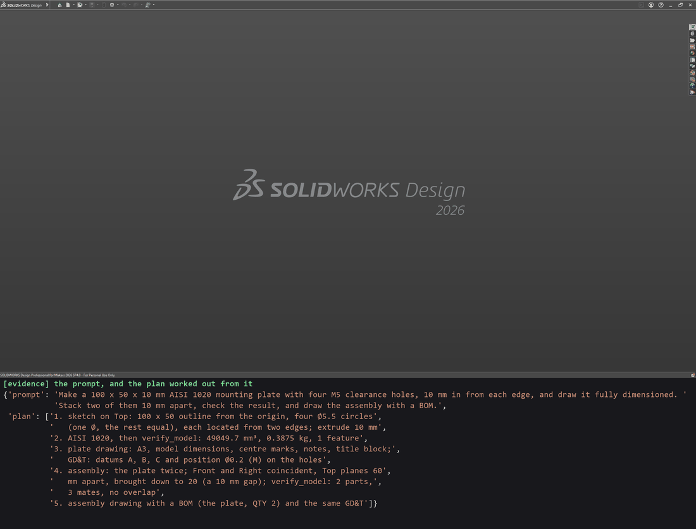

**Source:** [`tests/live/test_live_sw_readme_demo.py`](https://github.com/andrewbartels1/SolidworksMCP-python/blob/main/tests/live/test_live_sw_readme_demo.py)

## Checking a model against expected values {#verify-model}

`verify_model` reads the active part or assembly back from SolidWorks and
gives a pass or fail for each expected value. `create_extrusion`,
`create_revolve` and `create_cut_extrude` also report the volume and size
they changed. Each test compares SolidWorks' numbers with a hand
calculation. The parts are sketched through the adapter, and the calls below
are the MCP tool calls each test makes.

[`tests/live/test_live_sw_verify_model.py`](https://github.com/andrewbartels1/SolidworksMCP-python/blob/main/tests/live/test_live_sw_verify_model.py)

### A block that passes, and expectations that fail {#verify-block}

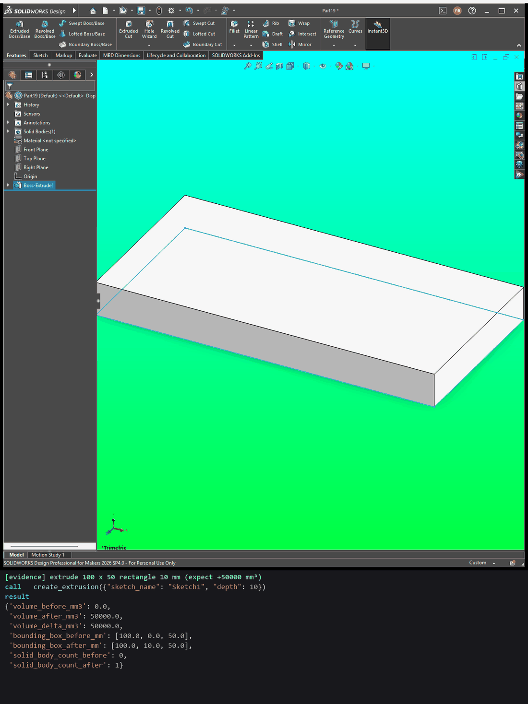

> *Example prompt:* Extrude a 100 x 50 rectangle 10 mm, make it AISI 1020,
> and check it is 50 000 mm³ and 0.395 kg, with one feature and one body.

**What it shows.** The extrusion reports +50 000 mm³. The block passes every
check. Asked for 60 000 mm³ and a 100 x 50 x 10 box in the wrong axis order,
it fails exactly those two checks and says the box is oriented differently.

**Tool calls**

1. `create_extrusion({"sketch_name": "Sketch1", "depth": 10})`
2. `verify_model({"volume_mm3": 50000, "mass_kg": 0.395, "bounding_box_mm": [100, 10, 50], "feature_count": 1, "solid_body_count": 1})`
3. `verify_model({"volume_mm3": 60000, "bounding_box_mm": [100, 50, 10]})`

### A round part's size is exact {#verify-round}

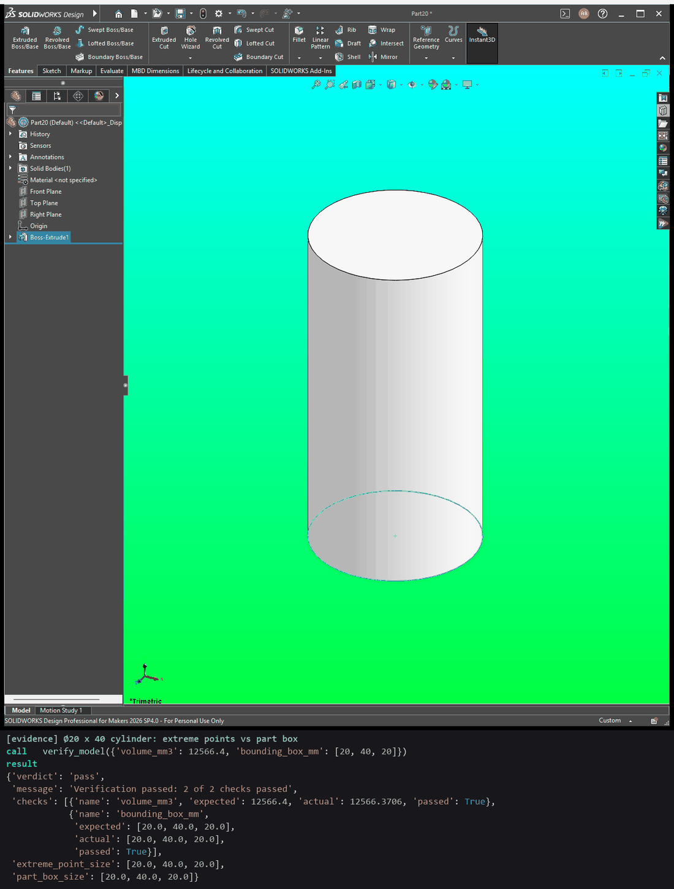

> *Example prompt:* Make a Ø20 x 40 mm cylinder and check its volume and
> size.

**What it shows.** The cylinder is 12 566.4 mm³ and 20 x 40 x 20 mm.
`verify_model` measures size from the part's extreme points, which are exact
on a round part; the caption shows SolidWorks' own part box beside it.

**Tool calls**

1. `create_extrusion({"sketch_name": "Sketch1", "depth": 40})`
2. `verify_model({"volume_mm3": 12566.4, "bounding_box_mm": [20, 40, 20]})`

### Reading the model keeps the selection {#verify-selection}

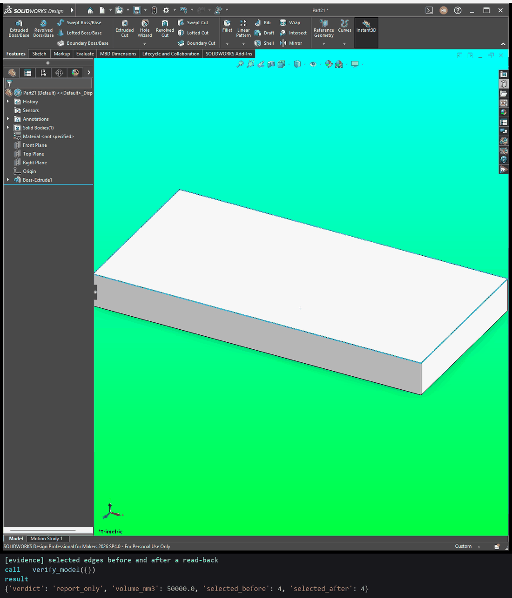

> *Example prompt:* Tell me the volume of this part without losing what I
> have selected.

**What it shows.** Four edges are selected before the call and are still
selected after it. With no expectations given, `verify_model` only reports
(verdict `report_only`) and does not rebuild the model.

**Tool calls**

1. `create_extrusion({"sketch_name": "Sketch1", "depth": 10})`
2. `verify_model({})`

### A revolve reports the volume it added {#verify-revolve}

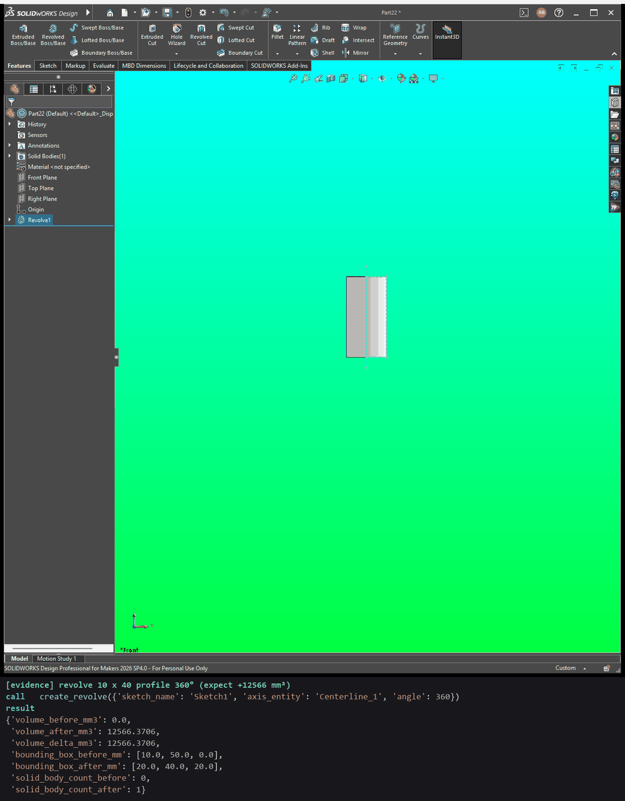

> *Example prompt:* Revolve a 10 x 40 mm profile 360° about the centreline
> and tell me how much material it added.

**What it shows.** The revolve's reply carries `measured_change`: +12 566 mm³
and a 20 x 40 x 20 mm box after.

**Tool calls**

1. `create_revolve({"sketch_name": "Sketch1", "axis_entity": "Centerline_1", "angle": 360})`

### A cut reports the volume it removed {#verify-cut}

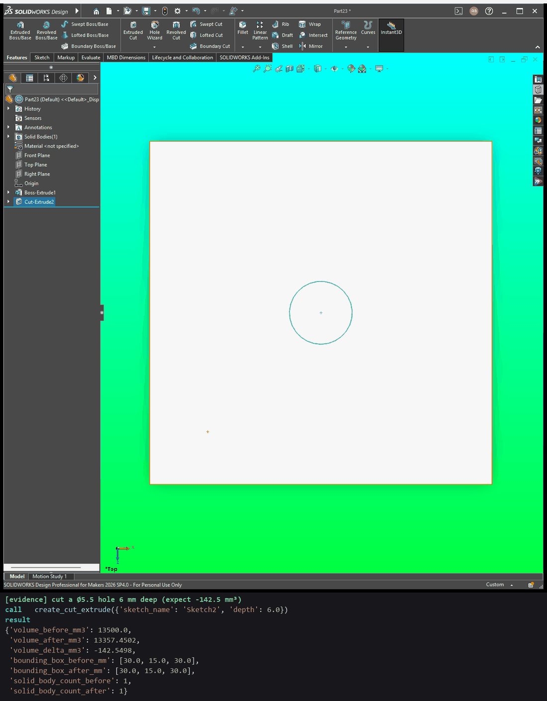

> *Example prompt:* Cut a Ø5.5 hole 6 mm deep in the middle of this block
> and tell me what it removed.

**What it shows.** The cut removes 142.5 mm³, and the block's outer size is
unchanged.

**Tool calls**

1. `create_extrusion({"sketch_name": "Sketch1", "depth": 15})`
2. `create_cut_extrude({"sketch_name": "Sketch2", "depth": 6})`

### An assembly: parts, mates and interference {#verify-assembly}

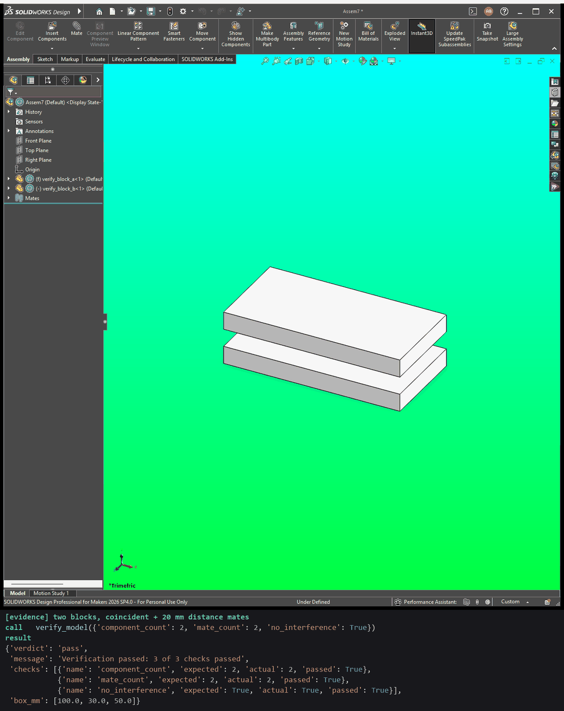

> *Example prompt:* Mate these two blocks 20 mm apart and check there are two
> parts, two mates and no interference.

**What it shows.** Two blocks, one coincident mate and one 20 mm distance
mate. `verify_model` counts 2 components and 2 mates, finds no interference,
and reports the assembly's size.

**Tool calls**

1. `verify_model({"component_count": 2, "mate_count": 2, "no_interference": true})`

## Drawing packages {#drawing-package}

The drawing-package tools make a complete drawing from a model, and set the
scale and BOM on an existing one. Each test checks what SolidWorks reports
afterwards, and one failure case.

[`tests/live/test_live_sw_drawing_package_tools.py`](https://github.com/andrewbartels1/SolidworksMCP-python/blob/main/tests/live/test_live_sw_drawing_package_tools.py)

### A full drawing package from one call {#package-block}

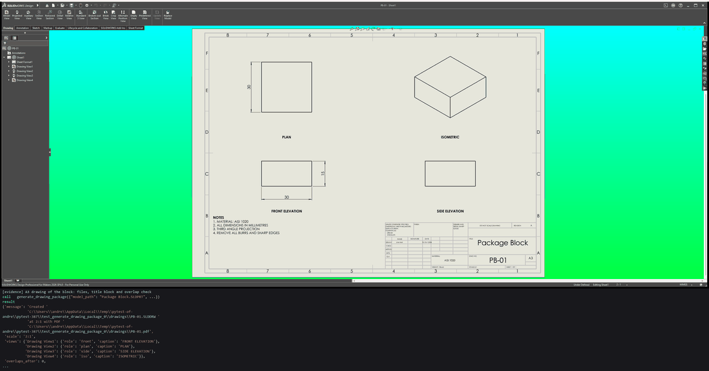

> *Example prompt:* Make an A3 drawing package of this block, drawing number
> PB-01, with a PDF.

**What it shows.** One call builds the drawing in seven steps, each shown as
it happens: the A3 ISO sheet; third-angle views and an isometric; the scale
and layout; the model dimensions, laid out; view captions and notes; an
overlap check on the real geometry; and the title block. The drawing and PDF
are written, the title block shows AISI 1020 and a weight of about 106 g, and
no dimensions overlap. A missing model and a drawing given as the model are
both refused.

**Tool calls**

1. `generate_drawing_package({"model_path": "Package Block.SLDPRT", "output_dir": "drawings", "title": "Package Block", "drawing_number": "PB-01", "author": "Live test"})`
2. `generate_drawing_package({"model_path": "no_such_part.SLDPRT"})`: `not_found`
3. `generate_drawing_package({"model_path": "PB-01.SLDDRW"})`: `invalid_input`

### Setting the sheet scale {#sheet-scale}

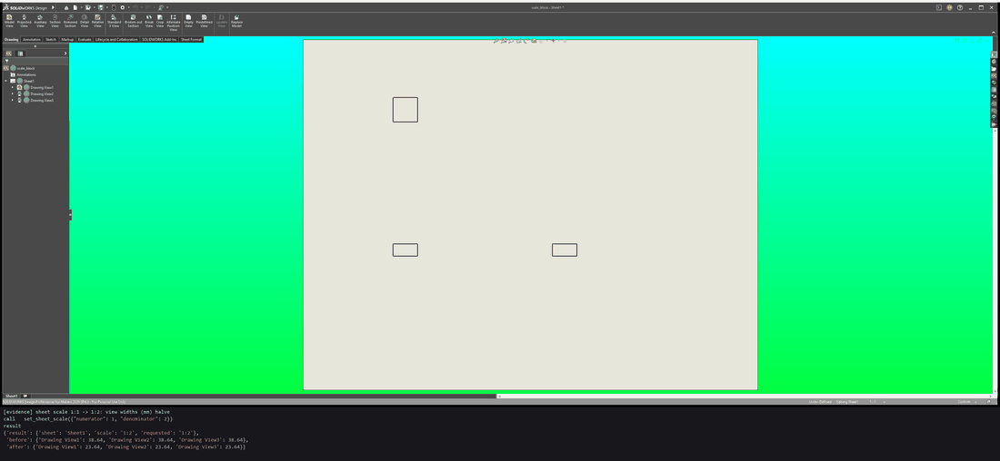

> *Example prompt:* Set this drawing's sheet scale to 1:2.

**What it shows.** The sheet reads back 1:2, and the 30 mm block shrinks
from 30 to 15 mm in every view. A scale of 0:2 is refused.

**Tool calls**

1. `set_sheet_scale({"numerator": 1, "denominator": 1})`
2. `set_sheet_scale({"numerator": 1, "denominator": 2})`
3. `set_sheet_scale({"numerator": 0, "denominator": 2})`: `invalid_input`

### A BOM on an assembly drawing {#bom}

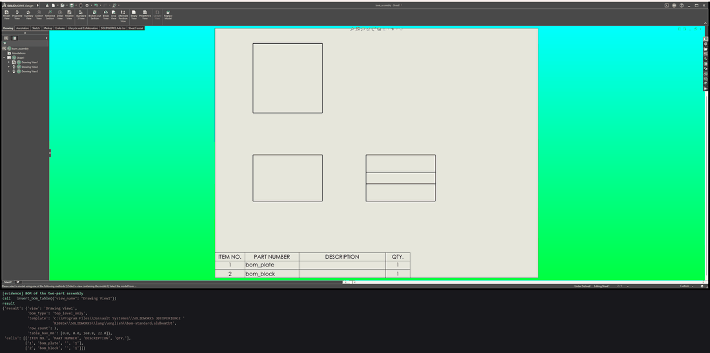

> *Example prompt:* Add a BOM to this assembly drawing.

**What it shows.** The BOM's own cells list both parts, and the table sits on
the sheet. An unknown view is refused with the list of views there are.

**Tool calls**

1. `insert_bom_table({"view_name": "Drawing View1"})`
2. `insert_bom_table({"view_name": "Side"})`: `not_found`

## Drawing dimensions {#drawing-dimensions}

Model dimensions are put on a drawing once each, then laid out so none
overlaps another dimension, a view or a note.

[`tests/live/test_live_sw_documentation_tools.py`](https://github.com/andrewbartels1/SolidworksMCP-python/blob/main/tests/live/test_live_sw_documentation_tools.py)

### Each model dimension shown once {#insert-model-dimensions}

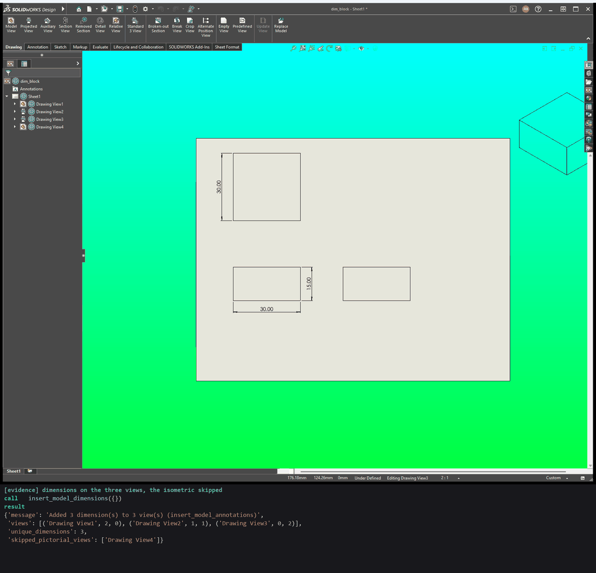

> *Example prompt:* Put the model's dimensions on this drawing.

**What it shows.** The dimensions go on the three orthographic views, each
dimension once across the sheet, and the isometric is skipped. An unknown
view is refused.

**Tool calls**

1. `insert_model_dimensions({})`
2. `insert_model_dimensions({"view_name": "Side"})`: `not_found`

### Clearing every overlap {#arrange-dimensions}

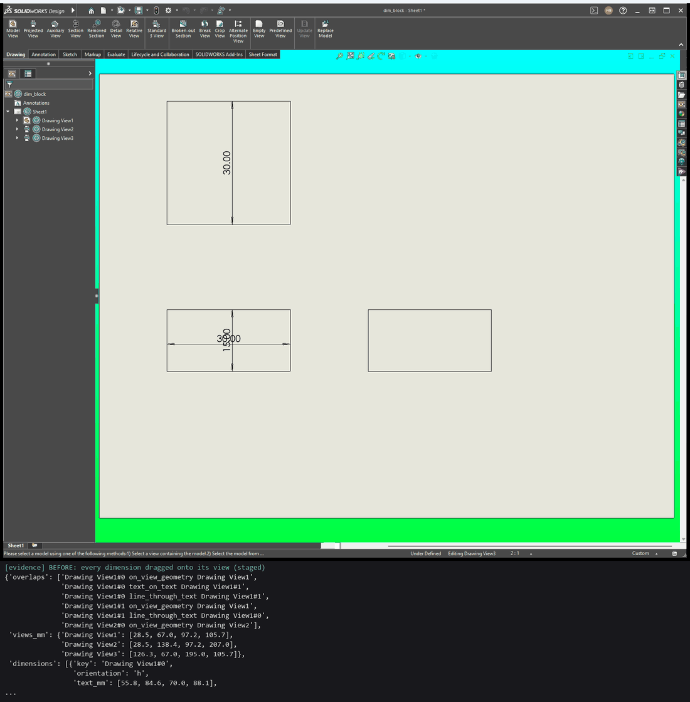

> *Example prompt:* Tidy the dimensions on this drawing so nothing overlaps.

**What it shows.** The test first drags every dimension onto the middle of
its view, the worst case. One call moves them all off, with no overlaps left.

**Tool calls**

1. `insert_model_dimensions({})`
2. `arrange_dimensions({})`

## Engineering data {#engineering-data}

Material, custom properties, dimensions, measurements and flat patterns, each
read back from SolidWorks.

[`tests/live/test_live_sw_documentation_tools.py`](https://github.com/andrewbartels1/SolidworksMCP-python/blob/main/tests/live/test_live_sw_documentation_tools.py)

### Material and mass {#material}

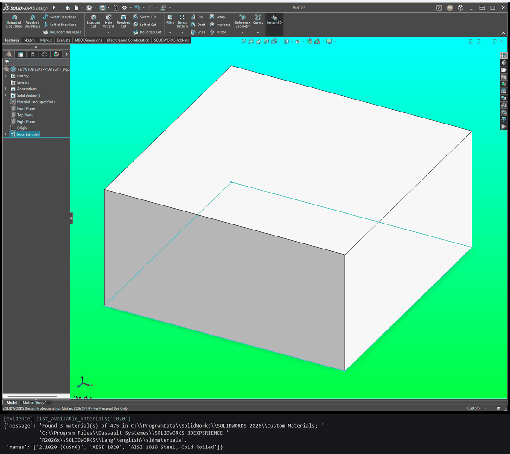

> *Example prompt:* Find AISI 1020 in the material library, apply it to this
> block and tell me its mass.

**What it shows.** The material is found, applied and read back. The
30 x 30 x 15 mm block weighs about 0.106 kg. An unknown material is refused.

**Tool calls**

1. `list_available_materials({"search": "1020"})`
2. `set_material({"material_name": "AISI 1020"})`
3. `get_material({})`
4. `set_material({"material_name": "Unobtainium"})`: error

### Custom properties {#custom-property}


> *Example prompt:* Set this part's PartNo property to LIVE-001.

**What it shows.** The property written is the property read back.

**Tool calls**

1. `set_custom_property({"name": "PartNo", "value": "LIVE-001"})`
2. `get_custom_properties({})`

### Listing dimensions and measuring a face {#dimensions-and-measure}

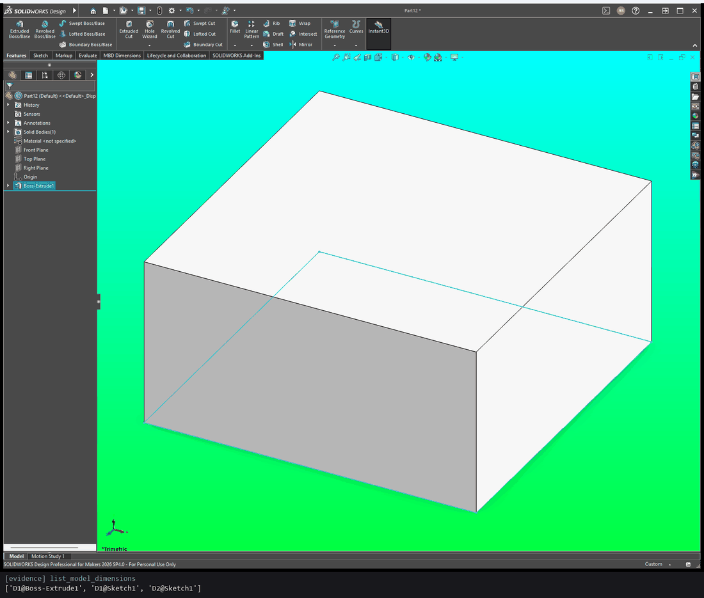

> *Example prompt:* List this part's dimensions and measure the area of its
> top face.

**What it shows.** The model's own dimension names, from the sketch and the
extrusion. The top face measures 900 mm², the 30 x 30 sketch. A feature that
does not exist is `not_found`.

**Tool calls**

1. `list_model_dimensions({})`
2. `measure_entities({"entities": ["face:0.015,0.015,0.0"]})`
3. `list_model_dimensions({"feature_name": "Fillet9"})`: `not_found`

### Flat pattern of a sheet-metal part {#flat-pattern}

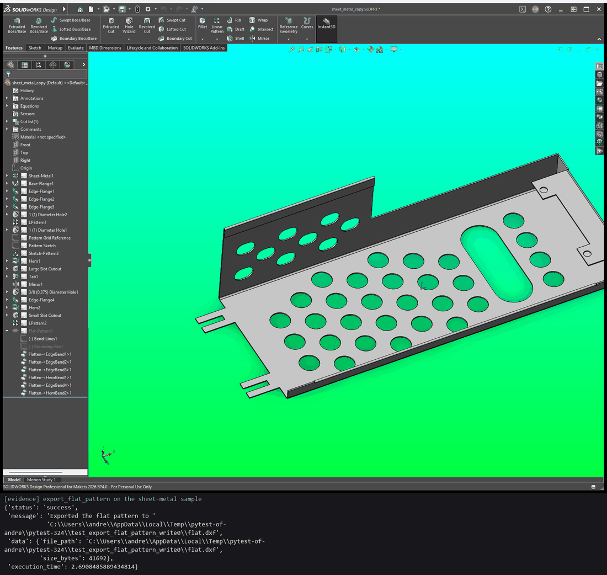

> *Example prompt:* Export this sheet-metal part's flat pattern as a DXF.

**What it shows.** A copy of SolidWorks' "Simple Sheet Metal Part" sample is
flattened and written as a DXF with its header and entities.

**Tool calls**

1. `export_flat_pattern({"file_path": "flat.dxf"})`

### A flat pattern of a solid part is refused {#flat-pattern-refused}

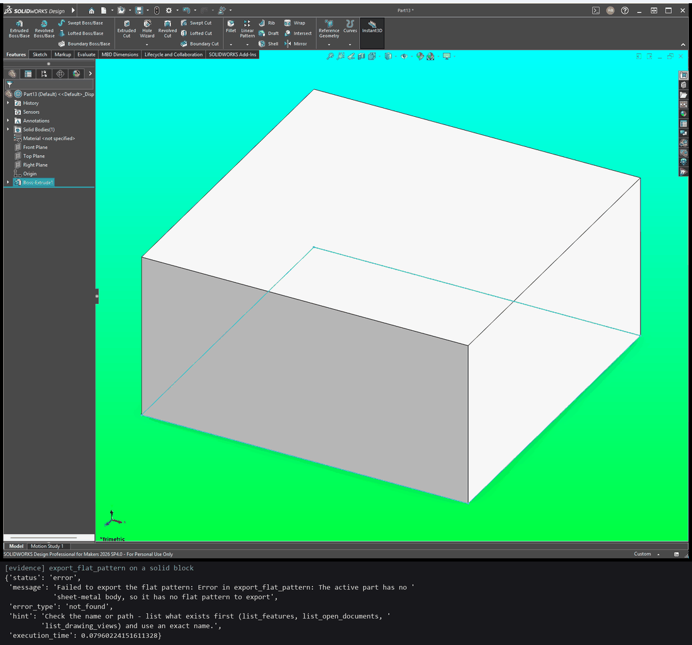

> *Example prompt:* Export this block's flat pattern as a DXF.

**What it shows.** A block has no sheet-metal body, so the call is refused
with `not_found` and a message saying so, and no file is written.

**Tool calls**

1. `export_flat_pattern({"file_path": "flat.dxf"})`: `not_found`

## Run a demo yourself

The demos need Windows, SolidWorks open and idle, and the project's `.venv`.
`live_demo.ps1` runs one test, paced so you can follow it in SolidWorks, and
closes every open document first.

```powershell
# Watch it run
powershell -ExecutionPolicy Bypass -File tests\scripts\live_demo.ps1 `
    -Test tests/live/test_live_sw_readme_demo.py

# Save a captioned frame per call and build a GIF
powershell -ExecutionPolicy Bypass -File tests\scripts\live_demo.ps1 `
    -Test tests/live/test_live_sw_readme_demo.py -CaptureDir docs/assets/demos/readme

# Also record the window and build the sped-up motion GIF
powershell -ExecutionPolicy Bypass -File tests\scripts\live_demo.ps1 `
    -Test tests/live/test_live_sw_readme_demo.py -CaptureDir docs/assets/demos/readme -Record
```

With `-Record`, a 10 s countdown comes first: bring SolidWorks to the front
and leave it uncovered, as the recorder copies the screen.

The repository also has standalone demo scripts, which build a part without
the test harness:

| Script | What it builds |
| --- | --- |
| [`scripts/demo_sketches.py`](https://github.com/andrewbartels1/SolidworksMCP-python/blob/main/scripts/demo_sketches.py) | A decorative plate using every sketch tool: splines, arcs, polygons, ellipses, patterns, mirror, offset |
| [`scripts/demo_features.py`](https://github.com/andrewbartels1/SolidworksMCP-python/blob/main/scripts/demo_features.py) | A revolved ring with a cut slot, a fillet and a chamfer |
| [`scripts/demo_sweep_loft.py`](https://github.com/andrewbartels1/SolidworksMCP-python/blob/main/scripts/demo_sweep_loft.py) | A lofted cone and a swept coil spring in one multibody part |
| [`scripts/demo_analysis.py`](https://github.com/andrewbartels1/SolidworksMCP-python/blob/main/scripts/demo_analysis.py) | Model info, features, configurations and mass properties read back, and a dimension read and changed |
| [`scripts/demo_export.py`](https://github.com/andrewbartels1/SolidworksMCP-python/blob/main/scripts/demo_export.py) | One part exported to STEP, STL, IGES and PNG |
| [`scripts/demo_save_validation.py`](https://github.com/andrewbartels1/SolidworksMCP-python/blob/main/scripts/demo_save_validation.py) | Saving refuses a missing folder and an existing file unless overwrite is set |
| [`demo_recording_heat_insert.py`](https://github.com/andrewbartels1/SolidworksMCP-python/blob/main/docs/getting-started/tutorial-parts/demo_recording_heat_insert.py) | A recording-friendly build that prints the prompt and its own source first |
| [`list_features_assembly_demo.py`](https://github.com/andrewbartels1/SolidworksMCP-python/blob/main/docs/getting-started/tutorial-parts/list_features_assembly_demo.py) | `list_features` on a part and an assembly from the SolidWorks sample set |

Run a script with `.\.venv\Scripts\python.exe scripts\demo_sketches.py`.
