# Progress

How far to trust each tool, and how much of SolidWorks' COM API the project
reaches. Everything on this page is generated from the code by
`python -m solidworks_mcp.progress.generate`, and a test fails when it's out
of date, so it moves with every tool added or fixed.

## Support levels

Every tool has one level. It's in the tool's tags (`level:beta`). A beta or
experimental tool's description opens with it, and its successful results
carry it as `warning`.

| Level | Meaning |
| --- | --- |
| stable | Checked by a live test on real SolidWorks; every input used; no known fault. |
| beta | Works on SolidWorks, but has a known fault or covers only part of its COM call. The reason is shown with it. |
| experimental | Implemented, but not yet checked on real SolidWorks. |
| planned | Registered, but nothing implements it yet; every call returns `not_supported`. |

A fixed fault, or a new live test, moves a tool up a level: the table is
`src/solidworks_mcp/tools/support_levels.py`.

## Every tool

--8<-- "docs/assets/progress/tables.html"

## How COM coverage is counted

The core bar counts the methods of twelve interfaces most work goes through
(the application, documents, parts, assemblies, drawings, the feature and
sketch managers, selection, components, features and sketches). The table
under the tools lists them. A method counts as reached when the adapter source names it,
as an attribute (`model.ForceRebuild3`) or a string. The method names come
from a committed snapshot of the SolidWorks type library
(`docs/assets/progress/com_snapshot.json`, refreshed with
`python -m solidworks_mcp.progress.snapshot` after a SolidWorks upgrade).

A text scan can't tell `IFeature.Name` from `IComponent2.Name`, so the
figures are approximate. The whole-API figure is small because most of the
API's 5,985 method names serve features this project doesn't cover yet
(simulation, routing, PDM and so on).
