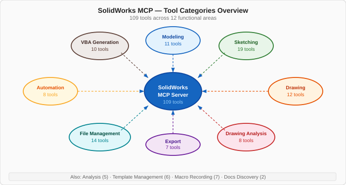
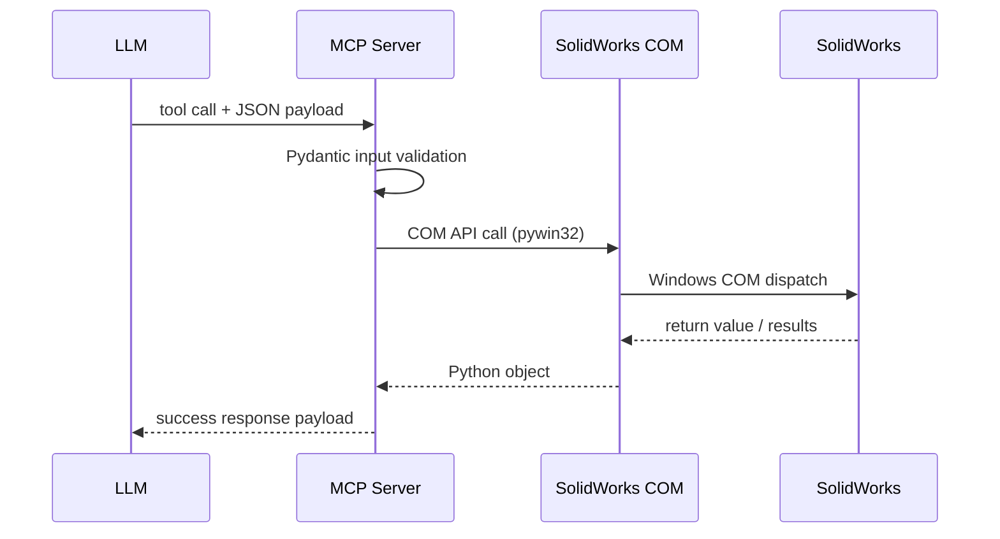

# Tool Catalog — All 139 Tools

This reference documents all **139 MCP tools** registered by the SolidWorks MCP server.
Each section covers one functional category with parameter tables and copy-paste sample calls.



## Quick Navigation

| Category | Count | Description |
|----------|-------|-------------|
| [Modeling Tools](modeling.md) | 42 | Parts, assemblies and drawings: extrusions, revolves, sweeps, lofts, cuts, Hole Wizard holes, cosmetic threads, shells, drafts, ribs, sheet metal (flanges, bends, the flat pattern), fillets, chamfers, patterns, reference geometry, mates, dimensions, feature renaming and the document unit system. |
| [Sketching Tools](sketching.md) | 19 | Sketches on a plane or a flat face: lines, circles, arcs, splines, polygons, relations, dimensions, offsets, mirrors and patterns. |
| [Drawing Tools](drawing.md) | 13 | Drawings from a model: views, notes and centre marks. Section and detail views, dimensions, the title block and a drawing check are planned. |
| [Drawing Analysis Tools](drawing-analysis.md) | 1 | Compare two versions of a drawing file. |
| [Drawing Automation Tools](drawing-automation.md) | 7 | Model dimensions laid out without overlaps, datum tags, tolerances, BOM tables, sheet scale and complete A3 drawings. |
| [Engineering Data Tools](engineering-data.md) | 8 | Read and edit the data drawings and BOMs are built from: model dimensions by name, measurements, materials, custom properties and sheet-metal flat patterns. |
| [Analysis Tools](analysis.md) | 4 | Check a finished part or assembly against expected values; mass, volume, centre of mass, inertia and interference. |
| [Export Tools](export.md) | 6 | STEP, IGES, STL, DWG, PDF and images. |
| [File Management Tools](file-management.md) | 20 | Open, save, switch and inspect documents; the feature tree, the live selection; create, activate and delete configurations; Pack and Go. |
| [Automation Tools](automation.md) | 1 | A VBA macro skeleton for a described task. |
| [VBA Generation Tools](vba-generation.md) | 10 | VBA macro text for steps the tools don't cover. |
| [Template Management Tools](template-management.md) | 1 | Compare two template files. |
| [Macro Recording Tools](macro-recording.md) | 1 | Run a binary SolidWorks macro (`.swp`). |
| [Docs Discovery Tools](docs-discovery.md) | 5 | Look up SolidWorks API interfaces and member signatures, read from the installed SolidWorks type library. |

`reset_circuit_breaker` (server admin) has no page of its own; see the
[progress page](../../progress.md). Eight tools are deprecated: each one's
section opens with "Deprecated" and names its replacement.

## Standard Response Envelope

A successful call returns at least:

```json
{
  "status": "success",
  "message": "Human-readable description",
  "data": { ... },
  "execution_time": 0.123
}
```

Every tool runs inside one error boundary, so a failed call always has the
same shape, whatever went wrong:

```json
{
  "status": "error",
  "message": "What failed and why",
  "error_type": "no_active_document",
  "hint": "Open or create a document first (open_model / create_part), or activate one with activate_document, then retry.",
  "execution_time": 0.012
}
```

`data` appears on an error only when the adapter returned diagnostics worth
keeping (for example `rebuild_model` lists the failing features). `error_type`
says what kind of failure it was; `hint` is the next step to take:

| `error_type` | Meaning |
|---|---|
| `invalid_input` | The arguments failed validation; nothing was sent to SolidWorks |
| `not_supported` | The active adapter cannot do this (e.g. the mock adapter, or a missing capability) |
| `no_active_document` | The tool needs an open document and there is none |
| `no_active_sketch` | The tool needs an open sketch and there is none |
| `wrong_document_type` | The active document is the wrong kind (e.g. a part where a drawing is needed) |
| `not_found` | A named feature, document, view, file, face or edge does not exist |
| `solidworks_unavailable` | SolidWorks was closed or crashed (RPC disconnect) |
| `circuit_open` | Calls are paused after repeated failures; retry after the breaker timeout |
| `com_wrong_thread` | A SolidWorks call ran off the thread that connected (a server bug; restart the server) |
| `com_member_not_found` | SolidWorks could not resolve an API member: usually a method the server forgot to flag (a server bug; report the tool), or a stale `gen_py` cache after a SolidWorks upgrade |
| `com_type_mismatch` | SolidWorks rejected an argument's COM type (a server bug; report it) |
| `feature_not_built` | SolidWorks accepted the call but the geometry gave it nothing to build (e.g. a cut whose profile misses the body in both directions); change the inputs, don't retry as is |
| `operation_failed` | SolidWorks refused or failed the operation; read `message` |
| `internal` | An unexpected server error (a bug; report the tool and arguments) |

## Request → Response Flow



## Calling Tools from an LLM

Pass parameters as a JSON object.  Only **required** fields (marked ✅) must be included.
All others default to sensible values.

```text
Goal: calculate mass of the open model

Tool: calculate_mass_properties
Payload: {}
```

```text
Goal: export active part to STEP

Tool: export_step
Payload:
{  "file_path": "C:\\Temp\\part.step" }
```
