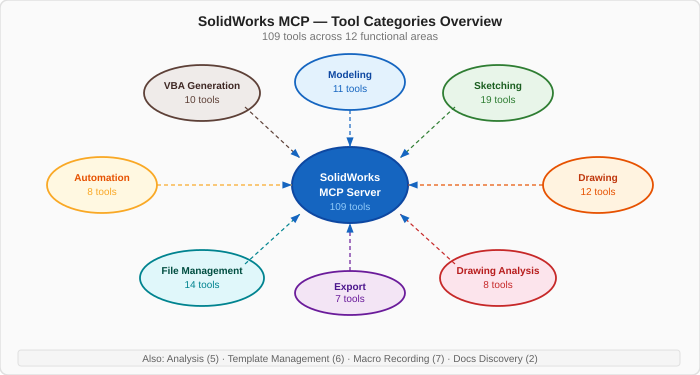
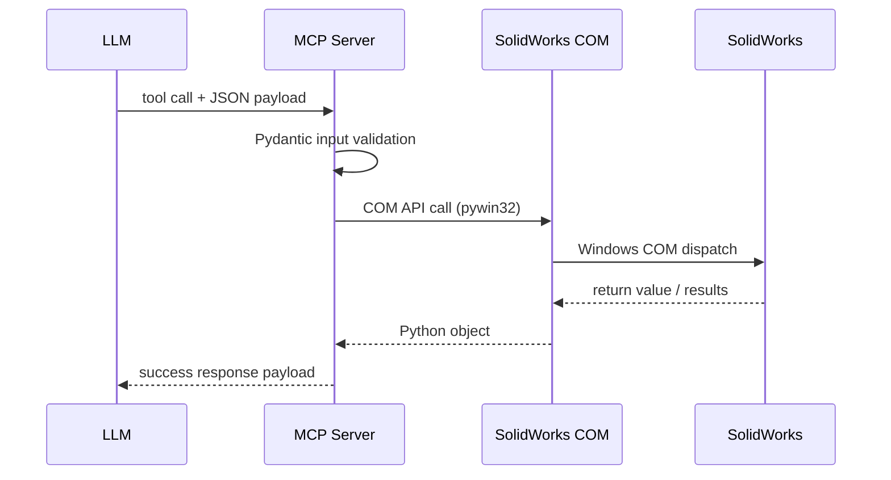

# Tool Catalog — All 151 Tools

This reference documents all **151 MCP tools** registered by the SolidWorks MCP server.
Each section covers one functional category with parameter tables and copy-paste sample calls.



## Quick Navigation

| Category | Count | Description |
|----------|-------|-------------|
| [Modeling Tools](modeling.md) | 30 | Create and manipulate SolidWorks parts, assemblies, and drawings — sketches, extrusions, revolves, dimensions, feature renaming, chamfers/fillets, and the document unit system. |
| [Sketching Tools](sketching.md) | 19 | Build 2-D sketch geometry (lines, circles, arcs, splines, polygons) and apply geometric constraints and dimensions. |
| [Drawing Tools](drawing.md) | 14 | Create and edit 2-D technical drawings: add projected, section, and detail views, place annotations, and auto-dimension layouts. |
| [Drawing Analysis Tools](drawing-analysis.md) | 8 | Quality-gate your drawings by analyzing dimensions, annotations, view coverage, standards compliance, and completeness. |
| [Drawing Automation Tools](drawing-automation.md) | 5 | Model dimensions laid out without overlaps, BOM tables, sheet scale, and complete A3 drawings. |
| [Engineering Data Tools](engineering-data.md) | 8 | Read and edit the data drawings and BOMs are built from: model dimensions by name, measurements, materials, custom properties and sheet-metal flat patterns. |
| [Analysis Tools](analysis.md) | 5 | Extract engineering properties from models, including mass, volume, center of mass, inertia, and material metadata. |
| [Export Tools](export.md) | 7 | Convert SolidWorks models to industry-standard interchange and manufacturing formats such as STEP, IGES, STL, DWG, PDF, and images. |
| [File Management Tools](file-management.md) | 19 | Open, save, and manage SolidWorks documents; load parts and assemblies, switch the active document, enumerate what's open, inspect model metadata, classify model families, and read the live UI selection. |
| [Automation Tools](automation.md) | 8 | Orchestrate multi-step workflows, run batch file processing, manage design tables, and tune performance settings. |
| [VBA Generation Tools](vba-generation.md) | 10 | Generate and execute VBA macro code for operations that exceed direct COM call complexity or require procedural automation. |
| [Template Management Tools](template-management.md) | 6 | Create, extract, apply, compare, and manage SolidWorks document templates in a reusable library workflow. |
| [Macro Recording Tools](macro-recording.md) | 7 | Record, replay, analyze, and optimize SolidWorks VBA macros, including macro libraries and batch execution workflows. |
| [Docs Discovery Tools](docs-discovery.md) | 2 | Introspect the live SolidWorks COM object library to discover available interfaces, methods, and practical API usage guidance. |

## Standard Response Envelope

A successful call returns at least:

```json
{
  "status": "success",
  "message": "Human-readable description",
  "data": { ... },
  "execution_time": 0.123
}
```

Every tool runs inside one error boundary, so a failed call always has the
same shape, whatever went wrong:

```json
{
  "status": "error",
  "message": "What failed and why",
  "error_type": "no_active_document",
  "hint": "Open or create a document first (open_model / create_part), or activate one with activate_document, then retry.",
  "execution_time": 0.012
}
```

`data` appears on an error only when the adapter returned diagnostics worth
keeping (for example `rebuild_model` lists the failing features). `error_type`
says what kind of failure it was; `hint` is the next step to take:

| `error_type` | Meaning |
|---|---|
| `invalid_input` | The arguments failed validation; nothing was sent to SolidWorks |
| `not_supported` | The active adapter cannot do this (e.g. the mock adapter, or a missing capability) |
| `no_active_document` | The tool needs an open document and there is none |
| `no_active_sketch` | The tool needs an open sketch and there is none |
| `wrong_document_type` | The active document is the wrong kind (e.g. a part where a drawing is needed) |
| `not_found` | A named feature, document, view, file, face or edge does not exist |
| `solidworks_unavailable` | SolidWorks was closed or crashed (RPC disconnect) |
| `circuit_open` | Calls are paused after repeated failures; retry after the breaker timeout |
| `com_wrong_thread` | A SolidWorks call ran off the thread that connected (a server bug; restart the server) |
| `com_member_not_found` | SolidWorks could not resolve an API member (usually a stale `gen_py` cache) |
| `com_type_mismatch` | SolidWorks rejected an argument's COM type (a server bug; report it) |
| `operation_failed` | SolidWorks refused or failed the operation; read `message` |
| `internal` | An unexpected server error (a bug; report the tool and arguments) |

## Request → Response Flow



## Calling Tools from an LLM

Pass parameters as a JSON object.  Only **required** fields (marked ✅) must be included.
All others default to sensible values.

```text
Goal: calculate mass of the open model

Tool: calculate_mass_properties
Payload: {}
```

```text
Goal: export active part to STEP

Tool: export_step
Payload:
{  "file_path": "C:\\Temp\\part.step" }
```
